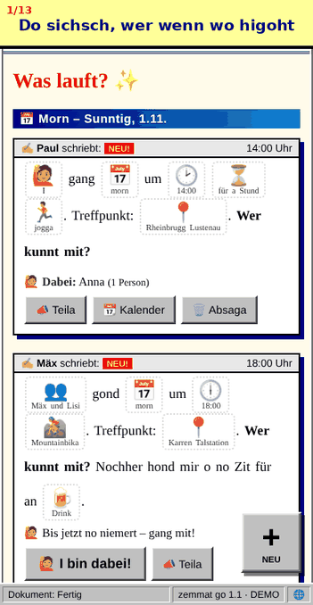
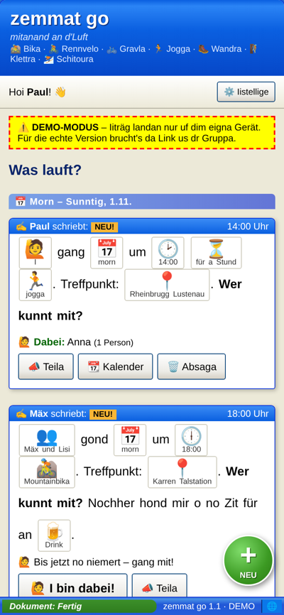

# 🏔️ zemmat go

**Mitanand an d'Luft.** Statt zwölf WhatsApp-Gruppa für Bika, Rennvelo, Gravla, Jogga, Wandra, Klettra und Schitoura gibt's eine Seite:
du tragst ii, wenn du gosch, und wer will, kunnt mit.

> *I gang morn um 14:00 für a Stund jogga. Wer kunnt mit?*

**👉 App: [paulrigger.github.io/zemmat-go](https://paulrigger.github.io/zemmat-go/)** · [Demo](https://paulrigger.github.io/zemmat-go/?demo)
<sub>Für die echte Version den Link mit Schlüssel (`?k=…`) aus der Gruppe verwenden.</sub>

<p>
  
  
  
</p>
<p>
  
  
</p>

---

## Funktionen

- **Liste der nächsten Termine**, nach Tag gruppiert (Hüt / Morn / Übermorn / Wochentag). Vorbei = verschwindet automatisch
- **➕ Neuer Termin als Lückentext** im Bilderbuch-Stil – auf die gelben Wörter tippen zum Ändern:
  - **Wer:** I · Mir · Paul und Anna (Verb passt sich an: *gang / gond*)
  - **Wenn:** hüt, morn, übermorn, Wochentage oder Datum
  - **Uhrzeit:** Schnellauswahl oder genaue Zeit (Uhr-Emoji passt zur Uhrzeit 🕑)
  - **Dauer** (optional), **Sportart** (oder „öppis anders“), **Treffpunkt** (optional, die letzten werden gemerkt)
  - **„Nochher hon i o no Zit für an Drink 🍺“** – Antippen streicht den Satz durch
- **🙋 I bin dabei!** / doch ned – Teilnehmer:innen stehen beim Termin
- **📣 Teilen** (Share-Sheet bzw. WhatsApp) mit direktem Link auf den Termin
- **📆 Kalender** – .ics-Datei zum Importieren
- **Kein Login:** Name wird beim ersten Mal abgefragt und lokal gespeichert
- Absagen kann nur, wer den Termin angelegt hat (Namensvergleich)
- PWA: „Zum Home-Bildschirm“ hinzufügen
- **🔔 Popups (Web Push)** bei neuen Terminen – pro Gerät einstellbar, für welche Sportarten. Eigene Termine lösen kein Popup aus.
  iPhone: ab iOS 16.4, **nur** wenn die App am Home-Bildschirm liegt. Android/Desktop: direkt im Browser.
- **⚙️ Iistellige:** Name, Popups (an/aus, Sportarten, Test-Popup), Design
- **🎨 Drei Designs:** 🌈 90er (Standard) · 🪟 Windows XP · 😐 Langweilig (modern, hell/dunkel, im Stil vom Fahrtenbuch)
- **Erklär-GIF** beim ersten Öffnen (später über ⚙️ → „Wia goht des?“)
- 90er-Look: WordArt, Laufschrift, Under Construction, Besucher-Zähler (= Einträge seit Anfang), Webring 😄

## Architektur

```
 ┌──────────────────────────┐   fetch (JSON)    ┌──────────────────────┐      ┌────────────────────┐
 │ GitHub Pages             │ ────────────────▶ │ Apps Script Web-App  │ ───▶ │ Google Sheet       │
 │ index.html + sw.js       │ ?k=… / POST text  │ api/Code.gs          │      │ Tabs Events, Abos  │
 └────────────▲─────────────┘ ◀──────────────── └──────────┬───────────┘      └────────────────────┘
              │ Push (Popup)                                │ neuer Termin → passende Abos
 ┌────────────┴─────────────┐    verschlüsselt   ┌──────────▼───────────┐
 │ Apple / Google / Mozilla │ ◀───────────────── │ Cloudflare Worker    │  VAPID + aes128gcm,
 │ Push-Dienst              │                    │ worker/worker.js     │  speichert nichts
 └──────────────────────────┘                    └──────────────────────┘
```

Apps Script kann die Web-Push-Kryptografie (ECDH, ES256) nicht, deshalb übernimmt das ein kleiner Cloudflare Worker (Gratis-Plan reicht).

- **Frontend:** eine einzige `index.html`, kein Framework, kein Build. Ist `API_URL` leer → Demo-Modus mit `localStorage`.
- **API:** Apps Script, an das Sheet gebunden. *Ausführen als: Ich*, *Zugriff: Jeder*, geschützt mit einem Schlüssel.
- **Daten:** nur im Google Sheet. Im Repo stehen weder Daten noch Schlüssel.

## Einrichtung (einmalig, ~5 Minuten)

1. Neues **Google Sheet** anlegen, z. B. „zemmat go“.
2. **Erweiterungen → Apps Script** → Inhalt von [`api/Code.gs`](api/Code.gs) einfügen.
   Unter Projekteinstellungen „appsscript.json im Editor anzeigen“ aktivieren und [`api/appsscript.json`](api/appsscript.json) übernehmen.
3. Funktion **`setup`** ausführen (Berechtigungen bestätigen) → im Ausführungsprotokoll stehen **Schlüssel** und **Gruppen-Link**.
4. **Bereitstellen → Neue Bereitstellung → Web-App** · Ausführen als: *Ich* · Zugriff: *Jeder* → `/exec`-URL kopieren.
5. In `index.html` oben eintragen:
   ```js
   const API_URL = 'https://script.google.com/macros/s/…/exec';
   ```
   committen → nach ~1 Minute live.
6. Gruppen-Link `https://paulrigger.github.io/zemmat-go/?k=SCHLÜSSEL` verteilen. Der Schlüssel wird im Browser gespeichert und aus der Adresszeile entfernt; geteilte Termin-Links enthalten ihn wieder.

## Popups einrichten (einmalig, ~10 Minuten)

**1. Cloudflare Worker**
1. [dash.cloudflare.com](https://dash.cloudflare.com) → Gratis-Account → **Compute (Workers) → Create → Hello World** → Name `zemmat-go-push` → Deploy.
2. **Edit code** → Inhalt von [`worker/worker.js`](worker/worker.js) einfügen → **Deploy**.
3. Worker-URL öffnen (`https://zemmat-go-push.<dein-name>.workers.dev/`). Die Seite zeigt einen frisch erzeugten **`VAPID_JWK`**.
4. **Settings → Variables and Secrets → Add**:
   - `VAPID_JWK` · Type **Secret** · Wert = der ganze JSON-Text von Schritt 3
   - `SECRET` · Type **Secret** · ein langes Zufallspasswort
   - optional `SUBJECT` · Text · `mailto:deine@adresse`
5. Worker-URL neu laden → `"ok": true`, `"secret": "gesetzt"`.

> Den `VAPID_JWK` **nicht mehr ändern** – sonst sind alle bestehenden Popup-Abos ungültig und müssen neu eingeschaltet werden.

**2. Apps Script**
1. Neuen [`api/Code.gs`](api/Code.gs) (v1.1) einfügen und speichern.
2. **Projekteinstellungen → Skripteigenschaften**: `PUSH_URL` = Worker-URL, `PUSH_SECRET` = gleiches Passwort wie `SECRET`.
3. Funktion **`setup`** einmal ausführen → legt Tab `Abos` an und fragt die neue Berechtigung „externe Dienste aufrufen“ ab.
4. **Bereitstellen → Bereitstellungen verwalten → ✏️ → Version: Neu → Bereitstellen** (URL bleibt gleich).

**3. Am Handy**
1. Gruppen-Link öffnen → **Teilen → Zum Home-Bildschirm** → App vom Home-Bildschirm starten.
2. ⚙️ **Iistellige** → Sportarten wählen → **🔔 Popups iischalta** → erlauben → **📣 Test-Popup**.

**Code-Änderungen an der API:** Bereitstellen → Bereitstellungen verwalten → ✏️ → Version „Neu“ (sonst bleibt die alte aktiv, URL bleibt gleich).
**Ohne Schlüssel betreiben:** Skripteigenschaft `KEY` löschen.
**Schlüssel tauschen:** `KEY` ändern → alte Links funktionieren nicht mehr.

## API

| Methode | Body / Parameter | Antwort |
|---|---|---|
| `GET` | `?action=list&k=…` | `{ok, version, events:[…], total}` (ab gestern, ohne abgesagte) |
| `POST` | `{action:"create", k, event:{von, datum, zeit, dauer, sport, sportText, wer, treffpunkt, drink}}` | `{ok, event}` |
| `POST` | `{action:"join"\|"leave", k, id, name}` | `{ok, event}` |
| `POST` | `{action:"cancel", k, id, name}` | `{ok}` – nur Ersteller:in |
| `POST` | `{action:"subscribe", k, sub, name, sports:[…]}` | `{ok}` – Push-Abo anlegen/aktualisieren (Schlüssel: endpoint) |
| `POST` | `{action:"unsubscribe", k, endpoint}` | `{ok}` |
| `POST` | `{action:"test", k, endpoint}` | `{ok, result}` – Test-Popup an dieses Gerät |

`list` liefert zusätzlich `push` = öffentlicher VAPID-Schlüssel (leer, solange Popups nicht eingerichtet sind).
Neuer Termin → Apps Script schickt alle Abos mit passender Sportart (außer Ersteller:in) an den Worker; abgelaufene Abos (404/410) werden gelöscht.

POST immer als `Content-Type: text/plain` (kein CORS-Preflight bei Apps Script). Fehler: `{ok:false, error:"…"}`.

## Datenmodell (Tab `Events`, alles Text)

| Spalte | Beispiel | Bemerkung |
|---|---|---|
| id | `a1b2c3d4` | |
| erstellt | `2026-10-31T17:50:00+01:00` | |
| von | `Paul` | Ersteller:in |
| datum / zeit | `2026-11-01` / `14:00` | |
| dauer | `h1` | `h05 h1 h15 h2 h3 halb ganz` oder leer |
| sport | `jogga` | `mtb rennrad gravel jogga wandra klettra schitour langlauf schwimma anders` |
| sportText | | nur bei `anders` |
| wer | `i` / `mir` / `Paul, Anna` | |
| treffpunkt | `Rheinbrugg` | optional |
| drink | `ja` / leer | |
| dabei | `Anna, Ben` | |
| status | leer / `abgsagt` | |

Tab `Abos`: `endpoint, p256dh, auth, name, sports, erstellt, aktualisiert` – ein Eintrag pro Gerät.

## Entwicklung

`index.html?demo` direkt im Browser öffnen → Demo-Modus. `?nointro` unterdrückt das Erklär-GIF.
Worker lokal testen: Krypto ist gegen `http_ece` (Referenz-Implementierung) geprüft. Demo-Daten zurücksetzen: `localStorage.removeItem('zg_demo')`.

## Ideen / Roadmap

- [ ] Kommentar pro Termin („I bin 10 Minuta später“)
- [ ] Filter nach Sportart
- [ ] Wiederkehrende Termine (z. B. jeden Mittwoch Lauftreff)
- [x] Popups bei neuen Terminen
- [ ] Popup an Ersteller:in, wenn jemand „dabei“ ist
- [ ] Lustenauer Dialekt-Modus 😉
